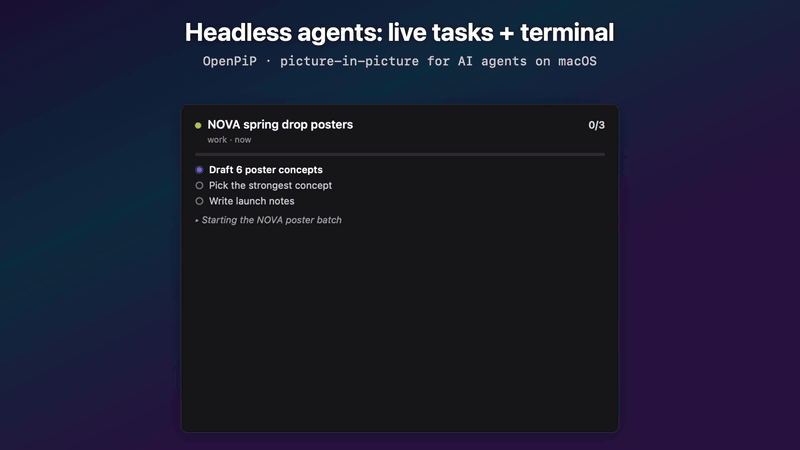

# openpip

picture-in-picture for your ai agents. on macos.

not sure why this didn't exist yet.



your agent is clicking around in some window. or it's running headless in a terminal you can't see.
or it just made 40 images in a folder you'll never find again.

openpip floats a tiny stack of cards over your screen so you can just... watch.

- **live window**: a mirror of the window your agent is using, cursor and all
- **headless agents**: their task list and terminal, straight from the claude code logs (openbot too)
- **images**: everything the agent opens or shares, in a film strip
- **tiny**: native swift, under 1 mb, no network, no analytics, nothing saved

## install

```bash
brew install --cask vcspr/tap/openpip
```

allow screen recording on first launch. that's it.

(not notarized, so macos might make you click "open anyway" once. it's fine. probably.)

## use

- menu bar icon → agents → pick one. or turn on auto-track and forget about it.
- click a back card to bring it up front. drag to move. scroll the film strip.
- or let your agent drive it, one line:

```bash
openpip-post step "clicking send" mail
```

the json event format, the claude code hook and every other knob live in [docs/reference.md](docs/reference.md).

## build it yourself

```bash
git clone https://github.com/vcspr/openpip.git && cd openpip
scripts/make-signing-cert.sh     # once, so macos remembers the permission between builds
scripts/build-app.sh --install
swift test
```

## next

windows and linux, in rust. the plan: [docs/crossplatform-spec.md](docs/crossplatform-spec.md)

## credits

100% vibe coded with my boi "claude" 🤝

mit license. do whatever.
